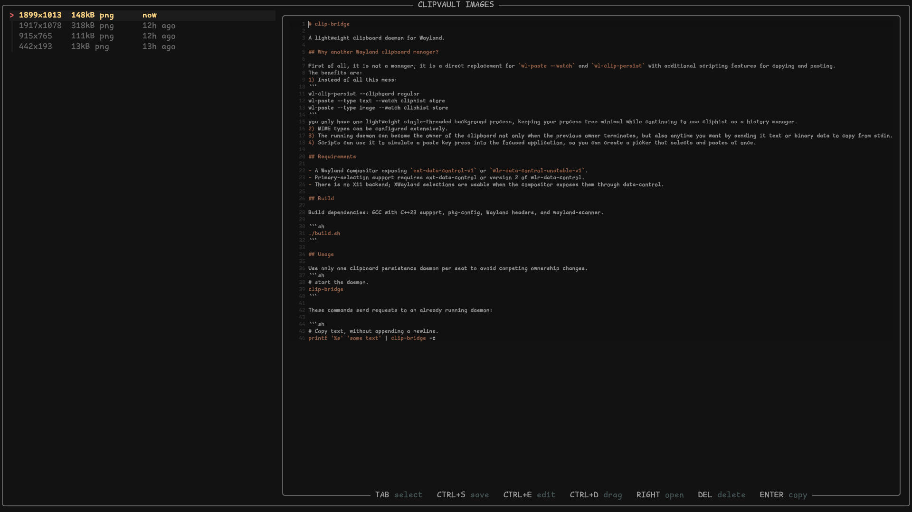

# clip-bridge

A lightweight clipboard daemon for Wayland.

## Why another Wayland clipboard manager?

First of all, it is not a manager; it is a direct replacement for `wl-paste --watch` and `wl-clip-persist` with additional scripting features for copying and pasting.

The benefits are:

1) Instead of all this mess:

    ```
    wl-clip-persist --clipboard regular
    wl-paste --type text --watch cliphist store
    wl-paste --type image --watch cliphist store
    ```

    you only have one lightweight single-threaded background process, keeping your process tree minimal while continuing to use cliphist as a history manager.

2) MIME types can be configured extensively.

3) The running daemon can become the owner of the clipboard not only when the previous owner terminates, but also anytime you want by sending it text or binary data to copy from stdin. No more stray wl-copy processes.

4) Scripts can use it to simulate a paste key press into the focused application, so you can create a picker that selects and pastes at once.

https://github.com/user-attachments/assets/78c5584e-8d72-4521-b18f-f995ac4450bd

## Requirements

- A Wayland compositor exposing `ext-data-control-v1` or `wlr-data-control-unstable-v1`.
- External clipboard history manager like `cliphist` or `clipvault`.
- Primary-selection support requires ext-data-control or version 2 of wlr-data-control.
- XWayland selections are usable when the compositor exposes them through data-control.

## Build

Build dependencies: GCC with C++23 support, pkg-config, Wayland headers, and wayland-scanner.

```sh
./build.sh
```

## Usage

Use only one clipboard persistence daemon per seat to avoid competing ownership changes.
```sh
# start the daemon.
clip-bridge
```

These commands send requests to an already running daemon:

```sh
# Copy text, without appending a newline.
printf '%s' 'some text' | clip-bridge -c

# Copy binary data with an explicit MIME type.
clip-bridge -c --type image/png < picture.png
clip-bridge -c -t application/octet-stream < data.bin

# Paste the current clipboard into the focused application.
clip-bridge -p

# Copy and then paste.
printf '%s' 'some text' | clip-bridge -cp
clip-bridge -cp -t image/png < picture.png
```

| Option | Meaning |
| --- | --- |
| No mode flag | Run the daemon. |
| -c | Read stdin and replace the regular clipboard. |
| -p | Inject the configured paste shortcut without changing the clipboard. |
| -cp | Copy stdin, then request a paste. Separate `-c -p` flags also work. |
| -t MIME (--type MIME) | MIME type for `-c` or `-cp`; defaults to `text/plain;charset=utf-8`. |
| --config PATH | Configuration file; daemon mode only. |
| -h (--help) | Print usage. |
| --version | Print the version. |

## Pasting

Pasting uses a Linux uinput virtual keyboard and the application with keyboard focus, so it works regardless of which compositor you are using.
clip-bridge waits for `paste_delay_ms` before sending a key press; by that time, the picker should exit and the desired app should gain keyboard focus.
To enable pasting with `-p` and `-cp`, grant your user access to `/dev/uinput` using the provided udev rule. Run this from the project directory:

```sh
sudo groupadd -f uinput
sudo usermod -aG uinput "$USER"
sudo install -Dm644 99-clip-bridge-uinput.rules /etc/udev/rules.d/99-clip-bridge-uinput.rules
```

You need to reboot for the group membership and the udev rule to take effect, then start the daemon. No root process or separate input daemon is needed.


## Configuration

The configuration path is `$XDG_CONFIG_HOME/clip-bridge/config.ini`, or `~/.config/clip-bridge/config.ini`.

The default configuration is:

```ini
command = cliphist store
mime_types = image/jpeg,image/*,image/png,text/plain;charset=utf-8,UTF8_STRING,text/plain,*
forward_all = false
clipboard = regular
persistence = lazy
paste_keybind = ctrl+shift+v
paste_delay_ms = 50
forward_sensitive = false
timeout_ms = 30000
min_size = 0
max_size = 0
```

Quotes and backslashes inside `command` can be used to group or escape individual arguments.

| Setting | Meaning |
| --- | --- |
| command | Command to receive each forwarded payload on stdin. An empty value disables history forwarding while allowing persistence. |
| mime_types | Comma-separated MIME patterns in forwarding preference order. An empty value disables forwarding. |
| forward_all | `false` forwards the first matching advertised type. `true` forwards every allowed type in configured order. |
| clipboard | Monitor `regular`, `primary`, or `both`. |
| persistence | `lazy`, `eager`, or `none`; see below. Applies to both monitored clipboards. |
| paste_keybind | Shortcut injected by `-p` and `-cp`. |
| paste_delay_ms | Delay before injecting paste keys, in milliseconds. |
| forward_sensitive | `false` excludes selections carrying `x-kde-passwordManagerHint` from both history and persistence. `true` bypasses that check. |
| timeout_ms | Inactivity timeout in milliseconds for clipboard transfers, history-command stdin, and unfinished copy uploads; `0` disables it. |
| min_size | Inclusive minimum payload size in bytes; `0` disables the lower bound. |
| max_size | Inclusive maximum payload size in bytes; `0` disables the upper bound. |

### MIME selection

Patterns are case-sensitive shell-style globs. Patterns are processed in configured order; the application's offer order breaks ties within a pattern.

For example:

```ini
mime_types = image/jpeg,image/*,text/plain;charset=utf-8,text/plain,*
forward_all = false
```

This prefers JPEG, then another image format, then the listed text formats. The final `*` allows remaining types. Without it, unmatched types are not forwarded.
`forward_all = false` means that only one type will be sent, the first available from the list.

### Persistence

- **`lazy`**: leave the original application as clipboard owner. When the selection becomes empty, confirm that no immediate replacement came after, then restore the captured data under clip-bridge's ownership.
- **`eager`**: take ownership of every copy, without waiting for the original owner to disappear.
- **`none`**: forward data to history without retaining a persistence backup or taking ownership of external selections.

## Example scripts

The example [scripts/](scripts/) use Clipvault history and use separate pickers for text and image entries.

### Text picker

`clipvault-text.sh` uses Rofi and AWK to list non-binary entries.
Tab toggles selection, Delete removes selected entries and reloads the list, and Escape cancels.
Multiple entries can be joined using different separators:

| Rofi keybind | Separator used for pasting |
| --- | --- |
| Enter | Newline |
| Ctrl+Space | Space |
| Ctrl+Comma | `,` |
| Ctrl+Alt+Comma | `, ` |
| Ctrl+a | ` and ` |
| Ctrl+Alt+a | ` & ` |
| Ctrl+Shift+a | ` && ` |
| Ctrl+o | ` or ` |
| Ctrl+Alt+o | ` \| ` |
| Ctrl+Shift+o | ` \|\| ` |
| Ctrl+Slash | `/` |
| Ctrl+Backslash | Backslash followed by a newline |
| Ctrl+Semicolon | `; ` |

Pressing any of these binds copies and pastes the selected text.

### Image picker

`clipvault-images.sh` uses fzf and Chafa to list and preview image entries with dimensions, size, format, and age.
It requires Bash, GNU AWK, GNU core utilities, and `file`, plus these tools for the corresponding actions:

| Shortcut | Action | Additional tool |
| --- | --- | --- |
| Tab | Toggle selection. | — |
| Enter | Copy the first returned image; do not paste. | — |
| Ctrl+S | Save selected images to `~/Pictures` and show a notification. | `notify-send`; `xdg-open` for the notification's folder action |
| Ctrl+E | Edit the focused image. | `swappy` |
| Ctrl+D | Drag selected images. | `dragon-drop` |
| Right | Export selected images into one directory and open its first image. | `xdg-open` |
| Delete | Delete selected entries and reload the list. | — |



## Acknowledgements

- [zzzclip](https://github.com/Osrepnay/zzzclip) — inspiration for combining clipboard persistence and history forwarding in one process.
- [clipse](https://github.com/savedra1/clipse) — reference for pasting through a uinput virtual keyboard.
- [wl-clip-persist](https://github.com/Linus789/wl-clip-persist) — reference for Wayland clipboard persistence.
- [wl-clipboard](https://github.com/bugaevc/wl-clipboard) — the clipboard watch-to-command workflow.
- [cliphist](https://github.com/sentriz/cliphist) — the default history backend.
- [Clipvault](https://github.com/Rolv-Apneseth/clipvault) — another history backend used by the example picker scripts.
